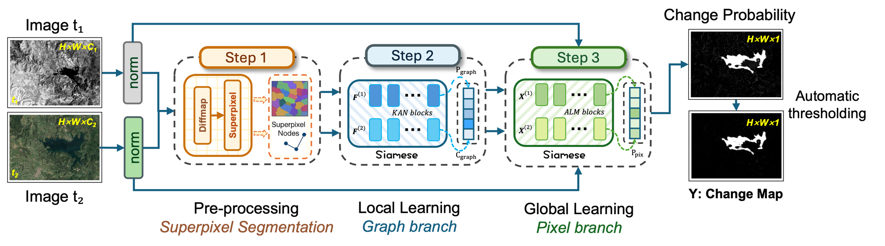
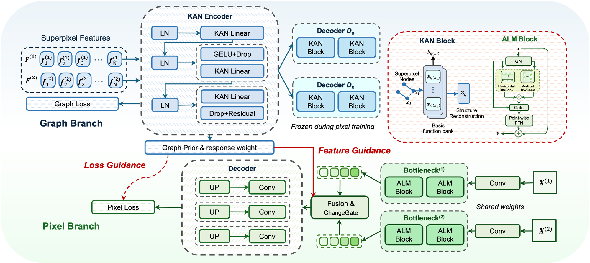
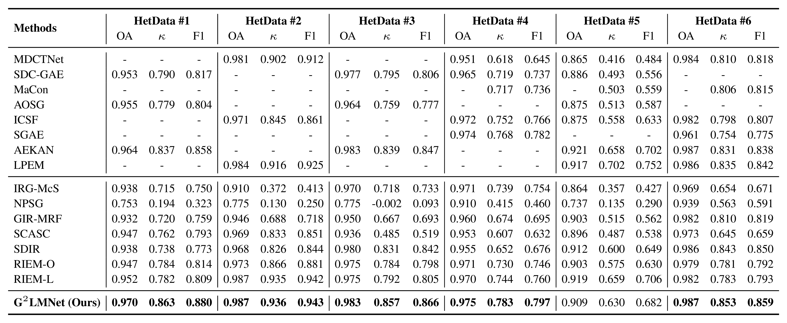
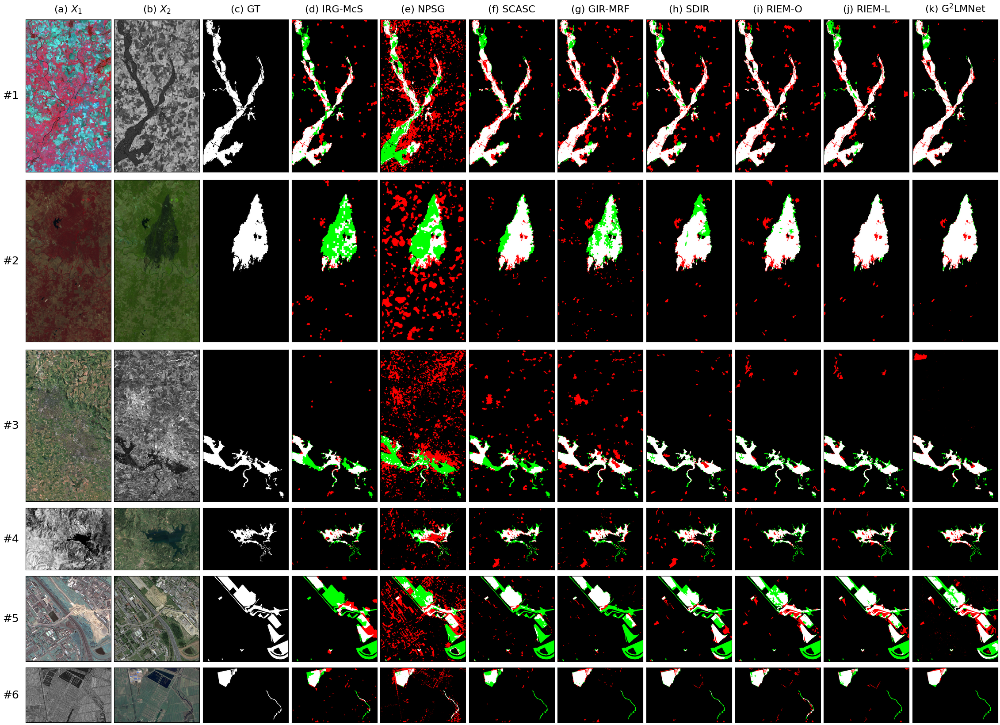

<div align="center">

# G²LMNet: Graph-Guided Pixel Refinement for Unsupervised Change Detection in Heterogeneous Remote Sensing Images

Yongjie Zheng, Hao Liu, Hui Zhao, Sicong Liu, Lorenzo Bruzzone

[](#citation)
[](LICENSE)
[](https://pytorch.org/)

</div>

Official PyTorch implementation of **G²LMNet** (Graph-Guided LightMamba Network) for unsupervised
binary change detection in heterogeneous remote sensing images (optical / SAR / cross-sensor).

## Method

Graph-based change detection is robust to modality differences but tends to over-smooth fine
structures; pixel-level networks keep detail but are unreliable in ambiguous regions. G²LMNet
combines the two in a **graph-to-pixel refinement** framework trained without any labels:

- **KAN graph branch.** Built on [AEKAN](https://github.com/TongfeiLiu/AEKAN-for-MCD), a Kolmogorov–Arnold encoder–decoder learns region embeddings on a shared
  co-superpixel partition. Latent change scores are smoothed on a weighted region-adjacency graph to
  give a structural change prior `P_graph` and a graph-response weight `C_graph`. This branch is
  pre-trained first and then frozen.
- **LightMamba pixel branch.** A U-Net with Axial LiteMamba (ALM) blocks, difference injection, ASPP
  and a prior-driven ChangeGate predicts a dense change-probability map `P_pix`.
- **Scheduled graph guidance.** Uncertain pixel predictions are corrected towards a graph-guided soft
  target with weight `W = w_g(e) · U_pix ⊙ C_graph`, where `w_g(e)` is a training schedule and
  `U_pix` is the pixel ambiguity.
- **Boundary-aware regularisation.** Edge-weighted total variation and gradient alignment sharpen
  change boundaries while keeping regions coherent.

The final change map is `P_pix` at the last training epoch, binarised with Otsu's threshold.

<p align="center"></p>
<p align="center"></p>

## Main Results

Quantitative comparison on six heterogeneous datasets (OA / κ / F1; "-" means not reported).

<p align="center"></p>

The change maps behind the G²LMNet row are provided in [`results/`](results) and can be scored with
`python tools/evaluate.py --pred_dir results --data_dir data/hetdata`.

Qualitative comparison (error maps: white = TP, black = TN, red = FP, green = FN; full-resolution
images in [`figures/comparison/`](figures/comparison)):

<p align="center"></p>

## Environment

Experiments were run on a single NVIDIA A100 GPU with:

- Python 3.8
- PyTorch 1.13.1 (CUDA 11.7)
- opencv-contrib-python 4.x (SLICO superpixels)
- pytorch-msssim 1.0, NumPy 1.24, SciPy 1.10

```bash
conda create -n g2lmnet python=3.8 -y && conda activate g2lmnet
pip install torch==1.13.1 --index-url https://download.pytorch.org/whl/cu117
pip install -r requirements.txt
```

## Usage

**Data.** Download `HetData_G2LMNet.zip` from the Releases page and unzip it to `data/hetdata/`
(see [`data/README.md`](data/README.md)).

**Train** (one dataset, or all six):

```bash
python tools/train.py --config configs/hetdata1.yaml --data_dir data/hetdata --work_dir work_dirs/hetdata1
bash scripts/train_all.sh data/hetdata work_dirs
```

**Evaluate:**

```bash
python tools/evaluate.py --pred_dir work_dirs --data_dir data/hetdata
```

Each run writes the final change map (`change_map.png`), its binary and error maps, the graph prior,
`metrics.json` and the training log to its `work_dir`. The settings of each dataset are in
[`configs/`](configs).

## Repository Structure

```
├── configs/      # hetdata1.yaml ... hetdata6.yaml
├── data/         # dataset instructions; put data/hetdata/*.mat here
├── figures/      # framework figures and qualitative comparison maps
├── g2lmnet/      # models (KAN graph branch, LightMamba pixel branch), losses, graph, superpixels, metrics
├── results/      # change maps of the reported results
├── scripts/      # train_all.sh, slurm_train.sh
└── tools/        # train.py, evaluate.py, make_figure.py
```

## Citation

The paper is currently under review. If you find this work useful, please cite:

```bibtex
@article{zheng2026g2lmnet,
  title   = {Graph-Guided Pixel Refinement for Unsupervised Change Detection in Heterogeneous Remote Sensing Images},
  author  = {Zheng, Yongjie and Liu, Hao and Zhao, Hui and Liu, Sicong and Bruzzone, Lorenzo},
  journal = {Under review},
  year    = {2026}
}
```

Our graph branch builds on AEKAN; please also cite their work
([paper](https://doi.org/10.1109/TGRS.2024.3515258), [code](https://github.com/TongfeiLiu/AEKAN-for-MCD)):

```bibtex
@article{liu2025aekan,
  title   = {{AEKAN}: Exploring Superpixel-Based AutoEncoder {Kolmogorov-Arnold} Network for Unsupervised Multimodal Change Detection},
  author  = {Liu, Tongfei and Xu, Jianjian and Lei, Tao and Wang, Yingbo and Du, Xiaogang and Zhang, Weichuan and Lv, Zhiyong and Gong, Maoguo},
  journal = {IEEE Transactions on Geoscience and Remote Sensing},
  volume  = {63},
  pages   = {1--14},
  year    = {2025},
  doi     = {10.1109/TGRS.2024.3515258}
}
```

## Acknowledgements

This work builds on [AEKAN](https://github.com/TongfeiLiu/AEKAN-for-MCD) (Liu et al., IEEE TGRS 2025):
the KAN graph branch, its superpixel-based self-supervised training, the image preprocessing and the
evaluation utilities follow their released code. The KAN layer originates from
[efficient-kan](https://github.com/Blealtan/efficient-kan). We thank the authors of the compared methods
and the providers of the heterogeneous change detection datasets.

## License

This project is released under the [MIT License](LICENSE).
